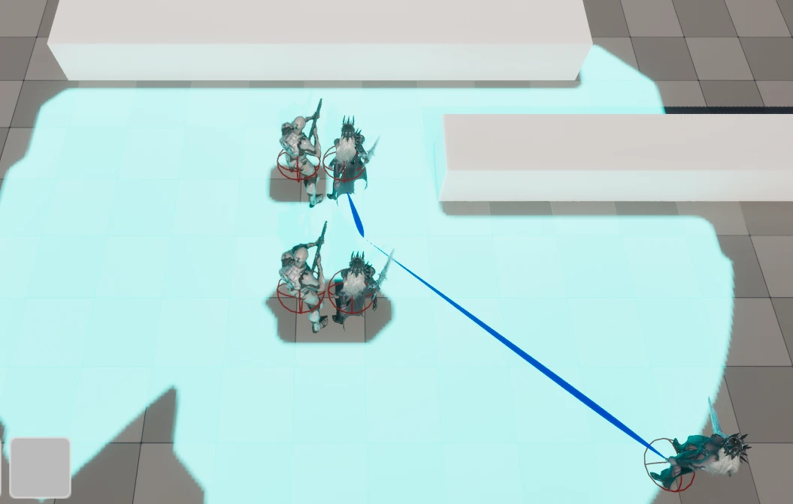

# UE-Samsara

1대1 턴제 전략 게임


개발일지

20261121

1. 나이아가라 이펙트를 사용해서 공격 사거리내의 작들을 표시
2. Spherecomponent의 자식 클래스인 rangecomponent클래스를 만들어서 사거리 기능 구현

20261122

1. 이동경로를 spline으로 표시하지 않고 effect로 표시하기 위해 MoveComponent를 만들었다.

20261125

1\.	RangeComponent에서 범위내에 모든 캐릭터를 이어주는 이펙트 생성

20261126

1. MoveComponent에서 이동 지점 설정과 이동 구현
   - 커서 위치까지 내비게이션 경로(PathPoints)를 찾아 경로 구간마다 이펙트로 표시하고, 경로 끝에 고스트를 놓아 이동 지점을 미리 보여 준다.
   - 좌클릭으로 이동 지점을 확정(SetTarget)하고, 이동을 시작하면 PathPoints를 하나씩 따라 이동한다.
2. 이동 경로(PathPoints)가 캐릭터 사이, 캐릭터와 벽 사이의 좁은 틈을 지나가지 않도록 내비게이션 설정 (아래 "기술 노트" 참고)

20261127

1. 이동 미리보기 경로가 MaxWalkSpeed보다 길면 경로를 따라 정확히 그 거리에서 잘라, 커서 쪽으로 갈 수 있는 가장 먼 지점까지 표시
2. 실제 이동 가능 범위(경로 길이 기준)를 바닥에 표시하는 데칼 컴포넌트 `MoveRangeComponent` 구현 (아래 "기술 노트" 참고)
3. 붙어 선 캐릭터에서 출발하면 경로가 꺾이는 문제의 원인과 해결 방향 정리 (아래 "기술 노트" 참고, 아직 구현 안 함)


---

# 기술 노트

## 이동 경로가 캐릭터 사이 좁은 틈을 지나가지 않게 하기

### 목표

`UMoveComponent`가 `UNavigationSystemV1::FindPathToLocationSynchronously`로 만드는 `PathPoints`가

- 캐릭터와 캐릭터 사이
- 캐릭터와 벽(장애물) 사이

의 틈이 **캐릭터 한 명의 폭보다 좁으면** 그 틈을 지나가지 않게 한다.

### 원리

경로는 내비메시(바닥에 깔린 초록색 영역) 위에서만 만들어진다. 그래서 "지나가면 안 되는 곳"을 내비메시에서 지우면 경로도 그곳을 피해 간다.

- **벽 쪽**: 내비메시는 벽에서 **Agent Radius**만큼 떨어진 곳까지만 깔린다. 벽 사이 틈이 `Agent Radius × 2`보다 좁으면 내비메시가 끊겨 경로가 생기지 않는다.
- **캐릭터 쪽**: 기본적으로 움직이는 캐릭터는 내비메시에 영향을 주지 않는다. 그래서 캐릭터 캡슐을 **다이내믹 장애물**로 등록해 캐릭터 자리에 내비메시 구멍을 뚫는다. 이 구멍은 엔진이 자동으로 **Agent Radius만큼 넓혀 준다** (`RecastNavMeshGenerator.cpp`의 `MarkDynamicArea`). 그래서 구멍 반지름 = 캡슐 반지름 + Agent Radius가 되고, 두 캐릭터 몸 사이가 캐릭터 한 명의 폭보다 좁으면 구멍끼리 이어져 경로가 막힌다.

### 1. 프로젝트 설정

**Project Settings → Engine → Navigation Mesh → Runtime → Runtime Generation = `Dynamic Modifiers Only`**

- 실행 중에 캐릭터 위치(장애물)를 내비메시에 반영하기 위해 필요하다.
- `Dynamic`보다 가볍다. 장애물 표시만 실시간으로 다시 계산한다.
- `Config/DefaultEngine.ini`에 이렇게 저장된다.

```ini
[/Script/NavigationSystem.RecastNavMesh]
RuntimeGeneration=DynamicModifiersOnly
```

- 바꾼 뒤에는 **Build → Build Paths**로 내비메시를 다시 만들고 맵을 저장한다. 실행 중 장애물을 덧입히는 데 필요한 데이터가 빌드할 때 함께 만들어진다.

### 2. Agent Radius = 캐릭터 캡슐 반지름

레벨의 **RecastNavMesh-Default** 액터 → **생성 → 에이전트 반경(Agent Radius)**

- 캐릭터 캡슐 반지름과 같게 맞춘다. 현재 값: 캡슐 반지름 **34**, Agent Radius **35**.
- 캡슐 크기는 `BP_ArhatAurora` 등의 **클래스 디폴트 → CapsuleComponent → 캡슐 반경 / 캡슐 절반 높이**에서 확인한다 (현재 34 / 88).
- 값을 바꾸면 **Build Paths**를 다시 실행한다.

### 3. 캐릭터 캡슐을 장애물로 등록 (`BaseCharacter.cpp` 생성자)

```cpp
#include "Components/CapsuleComponent.h"
#include "NavAreas/NavArea_Null.h"

// ACharacter는 시작할 때 캡슐의 CanEverAffectNavigation을 이 값으로 덮어쓴다. (기본 false)
// 이 값을 켜야 아래 캡슐 장애물 설정이 실제로 내비메시에 반영된다.
bCanAffectNavigationGeneration = true;
GetCapsuleComponent()->SetCanEverAffectNavigation(true);
GetCapsuleComponent()->bDynamicObstacle = true;   // 충돌 형태 대신 "장애물 영역"으로 내비메시에 반영
GetCapsuleComponent()->SetAreaClassOverride(UNavArea_Null::StaticClass());
```

| 코드 | 역할 |
|---|---|
| `bCanAffectNavigationGeneration = true` | **가장 중요.** 폰이 내비게이션에 영향을 줄 수 있게 한다. 아래 "주의할 점 1" 참고 |
| `SetCanEverAffectNavigation(true)` | 캡슐이 내비게이션에 영향을 줄 수 있게 한다 |
| `bDynamicObstacle = true` | 캡슐을 충돌 형태가 아니라 "장애물 영역(모디파이어)"으로 내비메시에 반영한다. 콜리전 설정과 상관없이 반영된다 |
| `SetAreaClassOverride(UNavArea_Null)` | 장애물 영역을 "지나갈 수 없는 영역"으로 만든다 |

`UNavArea_Null` 대신 `UNavArea_Obstacle`을 쓰면 완전히 막지 않고 "웬만하면 피하는" 영역이 된다 (다른 길이 없으면 지나감). 턴제에서는 캐릭터를 통과할 수 없으므로 `UNavArea_Null`을 쓴다.

캡슐의 충돌과 캐릭터 이동에는 영향이 없다. 내비메시에만 구멍이 뚫린다.

### 4. 움직이는 캐릭터 자신은 장애물에서 빼기 (`MoveComponent.cpp`)

3번을 적용하면 **이동하려는 캐릭터 자신**의 캡슐도 구멍을 뚫는다. 출발 위치가 구멍 안이 되어 경로를 못 찾으므로, 목적지를 고르는 동안과 이동하는 동안에는 자기 캡슐을 장애물에서 뺀다. 턴제라 한 번에 한 캐릭터만 움직이므로 이 방식으로 충분하다.

```cpp
void UMoveComponent::StartSetTarget()
{
	if (ABaseCharacter* Character = GetOwner<ABaseCharacter>())
	{
		Character->GetCapsuleComponent()->SetCanEverAffectNavigation(false);   // 자기 장애물 끄기
	}
	// ...
}

void UMoveComponent::FinishMove()
{
	// ...
	if (ABaseCharacter* Character = GetOwner<ABaseCharacter>())
	{
		Character->GetCapsuleComponent()->SetCanEverAffectNavigation(true);    // 이동이 끝나면 다시 켜기
	}
}
```

목적지를 고르다 중간에 그만두는 경우(빙의 해제 등)에도 다시 `true`로 돌려놓아야 한다.

### 5. 확인 방법

- **에디터 뷰포트에서 `P` 키**: 내비메시가 초록색으로 보인다. 벽에서 조금 떨어진 곳부터 깔리는지, 좁은 통로가 끊겨 있는지 본다.
- **플레이 중 콘솔(`~`)에 `show Navigation`**: 다른 캐릭터 주변에 둥근 구멍(반지름 약 69 = 캡슐 34 + Agent Radius 35)이 보여야 한다.
- 리슨 서버로 테스트할 때는 **경로를 만드는 쪽(조종하는 클라이언트) 창**에서 확인한다.

### 주의할 점 (실제로 겪은 문제)

1. **캡슐 설정만으로는 반영되지 않는다.**
   `ACharacter::UpdateNavigationRelevance()`가 게임 시작 시 `CapsuleComponent->SetCanEverAffectNavigation(bCanAffectNavigationGeneration)`을 호출해서, 생성자에서 켠 캡슐 설정을 **폰의 값(기본 false)으로 덮어쓴다.** 그래서 반드시 `bCanAffectNavigationGeneration = true`를 함께 켜야 한다.
   에디터에서는 블루프린트 **클래스 디폴트 → 폰 → 내비게이션 생성에 영향 주기 가능**에 체크되어 있는지로 확인할 수 있다.

2. **생성자 변경은 라이브 코딩으로 반영되지 않는다.**
   에디터를 닫고 빌드한 뒤 다시 열어야 블루프린트 기본값에 반영된다.

3. **블루프린트에서 값을 바꾸면 그 값이 우선한다.**
   `BP_BaseCharacter`, `BP_ArhatAurora` 등에서 캡슐의 내비게이션 항목을 직접 바꾸면 생성자 값이 무시된다. 이상하면 해당 항목 옆의 되돌리기 화살표로 기본값으로 돌린다.

4. **반영에 몇 프레임 걸린다.**
   장애물을 켜고 끄면 내비메시가 몇 프레임에 걸쳐 갱신된다. 목적지 고르기를 시작한 직후 한두 프레임은 이전 상태로 경로가 나올 수 있다.

5. **좁아 보여도 경로가 생기는 통로가 있다면** 그 통로가 실제로는 `Agent Radius × 2`(약 70)보다 넓은 것이다. 막고 싶으면 장애물 간격을 줄이거나 Agent Radius를 키운다.

6. **사거리 스피어(`RangeComponent`)는 내비메시에 영향을 주지 않는다.**
   폰 전체가 내비게이션에 영향을 줄 수 있게 되었지만, 컴포넌트는 콜리전이 켜져 있고 Pawn을 **막을(Block)** 때만 내비메시에 반영된다. 사거리 스피어는 Pawn과 겹치기(Overlap)만 하므로 구멍을 뚫지 않는다. 나중에 Pawn을 막는 컴포넌트를 캐릭터에 추가하면 그 컴포넌트도 내비메시에 구멍을 뚫으니 주의한다.

7. **붙어 서 있는 캐릭터에서 출발하면 경로가 출발 직후 꺾인다.** 아래 "출발점이 다른 캐릭터의 내비게이션 구멍 안에 있는 문제" 참고.


## 출발점이 다른 캐릭터의 내비게이션 구멍 안에 있는 문제

> 상태: 원인과 해결 방향만 정리함. **아직 구현하지 않음.**

### 증상

두 캐릭터가 어깨를 붙이고 서 있을 때, 그중 한 캐릭터의 이동 경로(PathPoints)가 **출발하자마자 한 번 꺾인 뒤** 목적지로 간다. 이동 가능 범위 데칼(`MoveRangeComponent`)도 출발 근처가 이상하게 계산될 수 있다.



- 위쪽에 두 캐릭터가 붙어 서 있고, 그중 오른쪽 캐릭터에서 오른쪽 아래 고스트(목적지)까지 파란 경로가 그려져 있다.
- 경로가 캐릭터 바로 아래에서 한 번 꺾인다. 직선으로 가면 되는 거리인데, 출발점이 옆 캐릭터의 구멍 안이라 먼저 구멍 밖으로 빠져나왔다가 목적지로 향하는 것이다.
- 스폰할 때 같은 팀이 한 지점에 몰려 서로 밀려나면서 이렇게 붙어 서게 되었다. 아래쪽 두 캐릭터도 같은 상태다.
- 하늘색 영역은 이동 가능 범위 데칼이다. 벽(흰 상자)과 캐릭터 주변이 파여 있는 것은 정상이다.

### 원인

캐릭터 캡슐을 내비게이션 장애물(`NavArea_Null`)로 등록했고, 엔진은 그 구멍을 Agent Radius만큼 넓힌다.

- 구멍 반지름 = 캡슐 반지름 34 + Agent Radius 35 = **약 69**
- 붙어 서 있는 두 캐릭터의 중심 사이 거리 = 캡슐 지름 = **약 68**

즉 붙어 서 있는 두 캐릭터는 **서로 상대방의 구멍 안에 서 있다.** 내비메시는 칸(복셀) 단위로 만들어져 구멍이 계산보다 조금 더 크게 잡히므로 더 확실하게 안쪽에 들어간다.

출발 위치가 구멍(지나갈 수 없는 영역) 안이면, 길찾기(`FindPathToLocationSynchronously`)는 **가장 가까운 내비메시 지점으로 출발점을 옮긴 뒤** 경로를 만든다. 그래서 경로가 먼저 옆 캐릭터의 구멍 밖으로 빠져나온 다음 목적지로 꺾인다.

확인 방법: 플레이 중 콘솔에서 `show Navigation`을 켜고, 이동하려는 캐릭터의 발밑이 옆 캐릭터의 구멍(초록색이 비어 있는 원) 안에 있는지 본다.

### 핵심: "모든 캐릭터는 서로의 구멍 밖에 있다"는 규칙

이 문제는 결국 **캐릭터가 내비메시가 금지한 자리에 서 있게 되는 것**이다. 그런데 정상적인 이동으로는 이 규칙이 깨지지 않는다.

- 이동 경로는 내비메시 위에서만 만들어지므로, 경로의 **모든 지점은 다른 캐릭터의 구멍 바깥**이다.
- 캐릭터는 그 경로를 따라 걷다가 멈추므로, 멈춘 자리도 구멍 바깥이다. `AcceptanceRadius`만큼 일찍 멈춰도 여전히 경로 위라서 바깥이다.
- 구멍은 서로 대칭이다. 내 중심이 상대 구멍 밖이면, 상대 중심도 내 구멍 밖이다.

그래서 **처음에 한 번 규칙이 지켜지면 이동해도 계속 지켜진다.** 규칙을 깰 수 있는 곳만 찾아서 막으면 된다.

### 규칙이 깨질 수 있는 곳

| 경우 | 현재 상태 | 대응 |
|---|---|---|
| **스폰** | `PvPGameMode::HandleMatchHasStarted`가 같은 팀 아라한을 **한 지점(`SpawnTransform`)에** 스폰하고, `AdjustIfPossibleButAlwaysSpawn`이 겹친 캐릭터를 밀어내면서 서로 딱 붙는다. **지금 생기는 꺾임의 원인.** | 스폰 직후 위치 보정, 또는 처음부터 떨어뜨려 스폰 (약 110 이상 간격) |
| **강제 이동** (넉백, 끌어당기기, 순간이동 스킬) | 아직 없음 | 강제 이동이 끝난 직후 위치 보정 |
| **충돌로 밀림, 멈출 때 미끄러짐** | 경로가 서로를 피해 가서 거의 없음 | 목적지 고르기 시작 시 안전장치로 보정 |

### 해결 방안 (추천)

규칙 하나를 정하고, 규칙이 깨질 수 있는 곳에서만 지키게 한다.

> **규칙: 캐릭터는 항상 내비메시가 허용한 자리에 서 있어야 한다.**

1. **위치 보정 함수 만들기**
   `BaseCharacter`에 "지금 자리가 허용된 자리가 아니면 가장 가까운 허용 위치로 옮기는" 함수를 둔다. `UNavigationSystemV1::ProjectPointToNavigation`으로 가장 가까운 내비메시 지점을 찾아 그 자리로 옮긴다.
2. **규칙이 깨질 수 있는 곳에서 호출**
   - 스폰 직후 (한 지점에 몰아서 스폰하더라도 보정됨)
   - 나중에 넉백 같은 강제 이동 스킬을 만들면, 그 이동이 끝난 직후
3. **안전장치**
   그래도 출발점이 구멍 안이면, 목적지 고르기를 시작할 때(`MoveComponent::StartSetTarget`) 한 번 보정한다. 꺾인 경로를 그리는 대신 캐릭터를 먼저 허용 위치로 옮기는 것이다.

이렇게 하면 앞으로 스킬이 늘어나도 **"강제로 위치를 바꾸는 곳에서는 보정 함수를 부른다"**는 규칙 하나만 지키면 된다.

주의: 보정 함수는 내비메시가 다른 캐릭터의 구멍을 이미 반영한 뒤에 불러야 정확하다. 스폰 직후처럼 장애물이 막 생긴 시점에는 내비메시 갱신에 몇 프레임 걸리므로, 짧게 기다린 뒤(타이머 등) 보정한다.

### 검토했지만 쓰지 않는 방법

| 방법 | 쓰지 않는 이유 |
|---|---|
| **스폰 간격만 두기** | 스폰은 해결되지만, 나중에 강제 이동 스킬이 생기면 같은 문제가 다시 생긴다. 근본 해결이 아니라 증상 하나만 막는다. (위치 보정과 함께 쓰는 것은 좋음) |
| **장애물 구멍을 작게 만들기** | 붙어 있는 캐릭터가 서로의 구멍 밖이 되지만, 그만큼 좁은 틈으로 경로가 다시 생긴다. "캐릭터 사이 좁은 틈을 지나가지 않게 하기"에서 해결한 문제가 되살아난다. |
| **가까운 캐릭터는 잠시 장애물에서 빼기** | 그 캐릭터를 뚫고 지나가는 경로가 생길 수 있다. |
| **`NavArea_Obstacle`(비용만 높은 영역)로 바꾸기** | 출발점 문제는 줄지만, 다른 길이 없으면 좁은 틈을 다시 지나간다. |
| **그대로 두기** | 실제 이동도 꺾인 경로를 따라가므로 동작은 일관되지만, 보기에 어색하고 이동 범위 계산도 출발 근처가 부정확해진다. |


## 이동 가능 범위 데칼 (`MoveRangeComponent`)

### 하는 일

목적지를 고르는 동안(S 키) 캐릭터가 이번 턴에 **실제로 이동할 수 있는 범위**를 바닥에 칠해서 보여 준다.

- 기준은 `MoveComponent`의 이동 규칙과 같다: 내비게이션 경로를 찾고 **PathPoints 구간 길이의 합이 MaxWalkSpeed 이내**면 이동 가능.
- 그래서 단순한 원이 아니라 **벽이나 다른 캐릭터 뒤쪽이 파인 모양**이 된다. 직선거리로는 가까워도 돌아가야 해서 경로가 길어지는 곳은 빠진다.
- 좌클릭으로 목적지를 확정하거나 빙의가 풀리면 숨긴다.

### 동작 방식

1. 캐릭터 주변(반지름 = MaxWalkSpeed인 사각형)을 `GridResolution x GridResolution` 칸으로 나눈다.
2. 칸마다 `FindPathToLocationSynchronously`로 경로를 찾고, 위 규칙으로 이동 가능 여부를 정한다.
   - 칸이 벽이나 다른 캐릭터 안이면 길찾기가 끝점을 가까운 바닥으로 옮기는데, 끝점이 칸에서 멀면 그 칸은 이동 불가로 본다.
3. 칸 결과로 `TextureResolution x TextureResolution` 텍스처를 만들어(이동 가능 = 흰색) 데칼 머티리얼의 `RangeMask` 파라미터에 넘긴다.
4. 턴제라 고르는 동안 주변이 변하지 않으므로 **Tick 없이 한 번에 계산**한다. 단, S를 누를 때 자기 캡슐의 내비게이션 장애물을 끄는 것이 내비메시에 반영되기까지 몇 프레임 걸리므로, **`StartDelay`(0.1초) 뒤 타이머로** 계산한다. 바로 계산하면 자기 구멍 안에서 출발하는 셈이라 전부 이동 불가로 나온다.
5. 계산 시간은 출력 로그에 `MoveRange: 48 x 48 cells computed in ... ms`로 남는다.

데칼 UV 방향: 데칼을 아래로 돌린 회전(Pitch -90)에서 **U = 월드 X, V = 월드 Y**다. (엔진 `DeferredDecal.usf`에서 UV = 데칼 로컬 (Z, Y))

### 문제: 범위가 동그랗지 않고 계단처럼 네모나게 보임

**원인**: 처음에는 칸 결과(32 x 32)를 **그대로 텍스처로** 썼다. 텍스처 한 픽셀이 칸 하나라서 경계가 칸 모양대로 계단이 되었다.

그 밖에 겹친 원인:
- 원 경계에 걸친 칸은 칸 중심이 원 밖이라는 이유로 빠져서, 바깥 원이 안쪽으로 깎였다.
- 원 바로 바깥 칸이 비어 있어서, 칸 사이를 보간한 경계가 **원보다 안쪽**에 생기는 곳이 있었다. 그 부분은 원이 아니라 칸 모양을 따라가서 각져 보였다.

### 해결 (코드에서 처리, 현재 적용됨)

**1. 경로 검사 칸과 표시 텍스처를 분리한다.**

| | 이전 | 지금 |
|---|---|---|
| 경로 검사 칸 (`GridResolution`) | 32 x 32 | 48 x 48 |
| 표시 텍스처 (`TextureResolution`) | 32 x 32 (칸 그대로) | 256 x 256 (따로 계산) |

경로 탐색 횟수는 칸 수로만 정해지고 텍스처 크기와는 상관없다. 텍스처를 키워도 계산 비용은 거의 늘지 않는다.

**2. 바깥 원은 칸과 상관없이 픽셀 단위로 정확하게 자른다.** (`RebuildMaskPixels`)

텍스처 픽셀마다 데칼 중심에서의 거리를 재서 반지름 밖이면 지운다. 경계 1픽셀은 부드럽게 처리한다(안티에일리어싱).

**3. 원 바깥 1.5칸까지 검사한다.** (`IsCellReachable`)

원 밖의 칸은 같은 방향의 원 안쪽 지점(반지름의 99%)으로 검사한다. 원 바로 바깥까지 "이동 가능"으로 채워 두면 칸 경계가 원 밖으로 밀려나고, 실제 바깥 모양은 2번의 픽셀 단위 원이 정하게 된다.

**4. 장애물 쪽 경계는 "흐리게 한 뒤 다시 또렷하게" 만든다.** (`RebuildMaskPixels`, `SampleReachable`)

- 주변 4칸을 거리 비율로 섞어(bilinear) 부드럽게 만든다.
- 가운데 + 상하좌우를 섞는 작은 블러를 더해 칸의 직각 모서리를 깎는다. 정도는 `EdgeRoundness`.
- `SmoothStep(0.4, 0.6)`으로 0.5 근처에서 다시 또렷하게 자른다.
- 흐리게만 하면 경계가 뿌옇고, 그대로 쓰면 계단 모양이라 둘을 섞는다.

### 다른 방법: 머티리얼에서 처리

코드 대신 데칼 머티리얼에서 같은 처리를 할 수도 있다.

1. **원 자르기**: `TextureCoordinate` → `Subtract 0.5` → `Length` → `Multiply 2` → `SmoothStep(0.98, 1.0)` → `OneMinus` = 원 마스크
2. **경계 다듬기**: `RangeMask`의 R → `SmoothStep(0.35, 0.65)`
3. 둘을 곱해서 색과 오파시티에 연결한다.

| | 머티리얼에서 처리 | 코드에서 처리 (현재) |
|---|---|---|
| 계산 위치 | GPU, 화면 픽셀마다 | CPU, 텍스처를 만들 때 한 번 |
| 값 조절 | 머티리얼 에디터에서 바로 보며 조절 | 값을 바꾸고 다시 실행 |
| 다른 머티리얼로 바꿀 때 | 그 머티리얼에도 같은 노드 필요 | 어떤 머티리얼이든 그대로 동작 |

머티리얼 방식으로 바꾸면 코드는 칸 결과를 그대로 넘기는 단순한 형태로 되돌리면 된다(텍스처 크기 = 칸 수, `RebuildMaskPixels`는 칸 값 복사만, `SampleReachable` 삭제). 단 **3번(원 바깥 칸까지 검사)은 남겨야** 한다. 이 칸들이 빠지면 머티리얼에서 원으로 잘라도 가장자리가 안쪽으로 깎인다.

### 데칼 머티리얼 설정 (`M_MoveRangeDecal`)

- **Material Domain**: `Deferred Decal`, **Blend Mode**: `Translucent`
- 마스크를 받는 노드는 **Texture Sample Parameter 2D** 하나만 두고, 이름을 정확히 **`RangeMask`**로 한다.
  - 이름이 다르면(예: `RangeMask1`, `RangeMask2`) 코드가 텍스처를 못 넣어서, 계산 결과 대신 노드에 지정된 기본 텍스처가 그대로 보인다. 실제로 겪은 문제.
  - 이름을 바꾸기 싫으면 컴포넌트의 `Mask Parameter Name`을 노드 이름에 맞춘다.
  - 노드에 지정한 기본 텍스처는 실행 중에 코드가 덮어쓰므로 **에디터 미리보기에만** 쓰인다.
- 마스크의 **R** 출력을 색 곱하기와 **오파시티** 둘 다에 연결한다. 오파시티를 상수 1로 두면 이동할 수 없는 곳까지 데칼의 사각형 범위 전체가 칠해진다.
- **Sampler Source**는 `From texture asset`으로 둔다. 코드가 텍스처를 부드러운 보간(bilinear)으로 만들어 넘기므로, 포인트 계열이면 계단이 그대로 보인다.
- 블루프린트에서 **MoveRangeComponent → Decal Material**에 지정한다.

### 추천 값 (MaxWalkSpeed 약 600 기준)

| 항목 | 값 | 이유 |
|---|---|---|
| Grid Resolution | 48 | 칸 하나가 약 25 단위로 캐릭터 반지름(34)보다 작아 지나갈 수 있는 틈을 놓치지 않음. 64면 경로 탐색이 약 1.8배 |
| Texture Resolution | 256 | 화면에서 충분히 매끄러움. 512는 차이에 비해 다시 그리는 비용이 4배 |
| Edge Roundness | 0.6 | 0.8 이상이면 캐릭터 한 명이 겨우 지나가는 좁은 통로가 메워져 보일 수 있음 |
| Start Delay | 0.1 | 자기 장애물 해제가 반영되기를 기다리는 시간. 전부 이동 불가로 나오면 0.2로 |
| Projection Depth | 200 | 캐릭터 중심(바닥에서 약 88 위)에서 바닥까지 닿음 |

계산 시간 확인: 출력 로그의 `MoveRange: ... ms`를 본다. 10ms 이하면 그대로, 수십 ms라 멈칫하면 Grid Resolution을 낮춘다(칸 수의 제곱에 비례).

