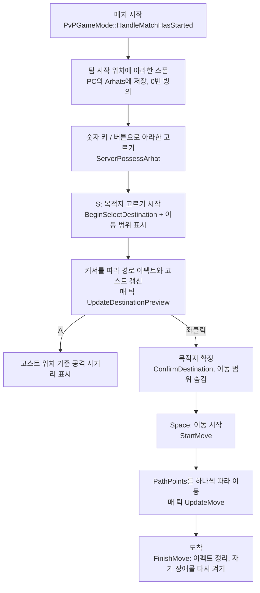

# UE-Samsara

언리얼 엔진 5.8 C++로 만드는 **1대1 턴제 전략 게임**.

두 플레이어가 각자 아라한(캐릭터) 여러 명을 골라 싸운다. 턴마다 캐릭터를 골라 이동할 곳을 정하고, 공격과 스킬로 상대 아라한을 쓰러뜨린다.

<!-- 스크린샷: Docs/Images 폴더에 넣고 아래 줄 주석을 풀면 된다 -->
<!--  -->


## 주요 기능

| 기능 | 설명 |
|---|---|
| 아라한 선택 | 화면 아래 버튼이나 숫자 키로 조종할 아라한을 고른다 |
| 이동 미리보기 | 커서까지의 내비게이션 경로를 이펙트로 그리고, 도착 지점에 반투명 고스트를 보여 준다 |
| 이동 거리 제한 | 경로 길이가 MaxWalkSpeed를 넘으면 그 거리에서 경로를 자른다 |
| 이동 가능 범위 | 실제로 갈 수 있는 범위를 바닥 데칼로 칠한다 (벽이나 캐릭터 뒤는 파임) |
| 좁은 틈 차단 | 캐릭터 사이, 캐릭터와 벽 사이 좁은 틈으로는 경로가 생기지 않는다 |
| 공격 사거리 | 사거리 원을 보여 주고, 범위 안의 캐릭터를 이펙트로 이어 표시한다 |
| 멀티플레이 | 리슨 서버 1대1. 팀별 시작 위치(PvPPlayerStart)에 아라한을 스폰한다 |


## 조작법

| 키 | 동작 |
|---|---|
| 마우스 | 카메라 이동 |
| 1, 2 | 조종할 아라한 선택 |
| S | 이동할 곳 고르기 시작 (경로 미리보기, 이동 가능 범위 표시) |
| 마우스 왼쪽 클릭 | 이동할 곳 확정 |
| Space | 확정한 곳으로 이동 |
| A | 공격 사거리 표시 |

키는 `Content/Data`의 입력 데이터 에셋(DA_ArhatInput, DA_PCInput)과 Input Mapping Context에서 바꿀 수 있다.


## 개발 환경과 실행 방법

### 필요한 것

- Unreal Engine **5.8**
- Visual Studio 2022 (C++ 게임 개발 워크로드)
- Git, **Git LFS** (`.uasset`, `.umap`은 LFS로 저장됨)

### 받아서 실행하기

1. 저장소를 받는다.
   ```
   git clone https://github.com/bp-beginplay/UE-Samsara.git
   cd UE-Samsara
   git lfs pull
   ```
2. `Samsara.uproject` 우클릭 → **Generate Visual Studio project files**
3. `Samsara.sln`을 열고 `Development Editor` / `Win64`로 빌드한다. (또는 `Samsara.uproject`를 더블클릭하고 빌드하겠냐는 창에서 예)
4. 에디터가 열리면 시작 맵 `Content/Maps/TestMap`이 열린다.

### 1대1 테스트

- 툴바의 플레이 옵션에서 **Number of Players = 2**, **Net Mode = Play As Listen Server**로 두고 플레이한다.
- 두 플레이어가 모두 들어오고 아라한 선택이 끝나면 게임이 시작된다 (`PvPGameMode::ReadyToStartMatch`).


## 폴더 구조

C++ 코드는 `Source/Samsara`에 있다. 헤더는 `Public`, 구현은 `Private`에 같은 폴더 이름으로 나뉜다.

| 폴더 | 내용 |
|---|---|
| `Actor` | GhostActor(이동 지점 미리보기), PvPPlayerStart(팀별 시작 위치) |
| `AnimInstance` | 아라한, 고스트 애니메이션 |
| `Character` | BaseCharacter(모든 아라한의 부모: 카메라, 입력, 컴포넌트), ArhatAurora, ArhatWraith |
| `Component` | MoveComponent(경로와 이동), MoveRangeComponent(이동 가능 범위 데칼), RangeComponent(사거리) |
| `Data` | 아라한 클래스 목록, 입력 데이터 에셋 |
| `GameInstance` | 게임플레이 태그로 아라한 클래스를 찾아 줌 |
| `GameMode` | PvP 매치 시작 조건, 아라한 스폰 |
| `HUD`, `UserWidget` | PvP 메인 메뉴, 아라한 선택 버튼 |
| `Interface` | TeamInterface(같은 팀인지 판단) |
| `PlayerController`, `PlayerState` | 아라한 빙의, 팀, 선택한 아라한 목록 |

에셋은 `Content` 아래 `Blueprint`, `Data`, `Maps`, `Assets`, `Resource`에 있다. 기술 노트에 쓰는 그림은 `Docs/Images`에 둔다.


## 이름 짓기 규칙

- 입력 액션은 `IA_` 뒤에 키 이름이 아니라 **하는 일**을 붙인다. (`IA_StartMove`, `IA_SelectArhat1`)
- 서버 RPC는 `Server`, 클라이언트 RPC는 `Client`로 시작한다. (`ServerPossessArhat`, `ClientOnUnpossessed`)
- 이펙트 에셋 변수는 `...System`, 만들어 둔 이펙트 컴포넌트 배열은 `...Components`로 짓는다.
- C++ 이름을 바꾸면 `DefaultEngine.ini`의 `[CoreRedirects]`에 옛 이름을 함께 적는다. (에셋에 저장된 값이 사라지지 않게)


---

# 개발일지

날짜는 커밋 시각(한국 시간) 기준이다. 항목 끝의 `abc1234`는 그 작업이 들어간 커밋이다.

### 한눈에 보기

| 날짜 | 한 일 |
|---|---|
| 2026-11-20 (금) | GitHub 저장소 만들기 |
| 2026-11-21 (토) | 프로젝트 첫 업로드, 사거리(RangeComponent), A/S 키 입력 |
| 2026-11-22 (일) | 이동 경로를 이펙트로 표시, 고스트가 커서를 따라다니게 함 |
| 2026-11-25 (수) | 사거리 안 캐릭터를 잇는 이펙트, 갈 수 없는 곳에서 고스트 숨기기 |
| 2026-11-26 (목) | MoveComponent로 이동 지점 설정과 이동, 캐릭터 사이 좁은 틈 차단 |
| 2026-11-27 (금) | A 키 공격 사거리, 이동 거리 제한, 이동 범위 데칼 머티리얼 |
| 2026-11-28 (토) | 이동 가능 범위 데칼(MoveRangeComponent), 전체 코드와 이름 정리, README와 기술 노트 새로 작성 |

---

### 2026-11-20 (금)

**추가**
- GitHub 저장소 생성 (README, Unreal용 `.gitignore`) `b18891c`

---

### 2026-11-21 (토)

**추가**
- UE 5.8 C++ 프로젝트 첫 업로드 `4e367f0` `8efbb3f` `c1b3bbc`
  - 게임 기본 구조: `PvPGameMode`(2인 접속 시 시작, 팀별 `PvPPlayerStart`에 아라한 스폰), 플레이어 컨트롤러/스테이트(팀, 고른 아라한), 아라한 선택 HUD와 버튼, `TeamInterface`
  - 아라한 `ArhatAurora`, `ArhatWraith`, 공통 부모 `BaseCharacter`(탑뷰 카메라, Enhanced Input)
  - GitHub 기본 `.gitignore`와 마켓플레이스 에셋 제외 규칙 합치기, `Resource` 폴더 추가
- `SphereComponent`의 자식 클래스 `RangeComponent`로 공격 사거리 구현 `8394906`
- 나이아가라 이펙트로 공격 사거리 안의 적 표시 `8394906`
- A 키(기본 공격 대상 정하기), S 키(이동 위치 정하기) 입력 추가 `e1cc43c`

---

### 2026-11-22 (일)

**추가**
- 이동 경로를 스플라인 대신 나이아가라 이펙트로 표시 (`NavPathComponent`) `eca8e12`
- 이동 지점을 고르는 동안 고스트(`GhostActor`)가 마우스를 따라다니게 함 `c6d4dfc`

---

### 2026-11-25 (수)

**추가**
- `RangeComponent`: 사거리 안의 모든 캐릭터를 이펙트로 이어 표시 `bf0ebd7`

**수정**
- 이동할 수 없는 지점을 가리키면 고스트를 없앰 `8029288`

---

### 2026-11-26 (목)

**추가**
- `MoveComponent`로 이동 지점 설정과 이동 구현 `e900435`
  - 커서까지 내비게이션 경로(PathPoints)를 찾아 구간마다 이펙트로 표시하고, 경로 끝에 고스트를 놓아 미리 보여 줌
  - 좌클릭으로 이동 지점 확정, Space로 PathPoints를 하나씩 따라 이동
- 캐릭터 사이, 캐릭터와 벽 사이 좁은 틈으로 경로가 생기지 않게 함 `e900435` (기술 노트 참고)
  - 캐릭터 캡슐을 내비게이션 장애물(`NavArea_Null`)로 등록, `bCanAffectNavigationGeneration` 켜기
  - 내비메시 런타임 생성을 `Dynamic Modifiers Only`로 변경

**정리**
- 이전에 시험하던 경로 컴포넌트(`PathComponent`, `RouteComponent`, `NavPathComponent`, `NavMoveComponent`)를 `MoveComponent` 하나로 합침 `e900435`
- README에 개발일지와 내비게이션 기술 노트 추가

---

### 2026-11-27 (금)

**추가**
- A 키로 공격 사거리 표시: 고스트가 있으면 고스트 위치, 없으면 캐릭터 위치 기준 `ca4b665`
- 이동 범위 데칼 머티리얼 `M_MoveRangeDecal` 추가 `dc42787`

**수정**
- 고스트를 목적지 고르기를 시작할 때 미리 생성 `ca4b665`
- 경로가 없거나 너무 길면 이전 미리보기를 그대로 유지 `ca4b665`
- 미리보기 경로가 MaxWalkSpeed보다 길면 경로를 따라 정확히 그 거리에서 자름 (커서 쪽으로 갈 수 있는 가장 먼 지점까지 표시) `5873743`

---

### 2026-11-28 (토)

**추가**
- 실제 이동 가능 범위(경로 길이 합 ≤ MaxWalkSpeed)를 바닥에 칠하는 데칼 컴포넌트 `MoveRangeComponent` `7498c88` (기술 노트 참고)
  - S 키로 표시, 목적지 확정이나 빙의 해제 때 숨김
  - Tick 없이 짧은 지연 뒤 한 번만 계산
  - 계단처럼 네모나게 보이던 경계를 둥글게 다듬음

**수정**
- 아라한 6번 버튼이 잘못된 번호의 아라한을 고르던 문제 `fcb40f1`
- `OnRep_Arhats`에서 아직 복제되지 않은 아라한을 써서 크러쉬가 나던 문제 `fcb40f1`

**정리** `fcb40f1`
- 전체 코드 정리: 접근 지정자 정리(외부에서 쓰는 것만 public), 긴 함수를 기능별 함수로 나눔
- 이름 정리: 입력 액션을 키 이름 대신 하는 일로 (`IA_ArhatS` → `IA_SelectDestination`), 함수 이름 (`StartSetTarget` → `BeginSelectDestination`)
- 오타 수정: `ArhatWarith` → `ArhatWraith`, `IA_ArhatMouxeXY` → `IA_CameraMoveMouse`
- 에셋 값이 사라지지 않도록 CoreRedirects 추가
- Wraith 블루프린트, 애니메이션 에셋과 폴더 이름의 `Warith` 오타 수정, 옛 태그로 저장된 에셋 다시 저장 `df206d3` `76bdce9`
- 쓰지 않는 코드 삭제
  - `SkillRange` 액터와 `BP_SkillRangeCircle` (이동 거리 원 데칼, `MoveRangeComponent`로 대체됨. 머티리얼 `M_SkillRangeDecal`은 사거리 원에 쓰려고 남김)
  - 바인딩하지 않던 WASD 카메라 입력 `IA_CameraMoveKeys` (S 키와 겹쳐서 빼 두었던 것)
  - 쓰지 않는 함수: `BindTriggeredAndCompleted`, `GetPathPoints`, `GetGhostMesh`, `GhostAnimInstance`의 빈 함수와 변수

**문서**
- 붙어 선 캐릭터에서 출발하면 경로가 꺾이는 문제의 원인과 해결 방향 정리 (아직 구현 안 함) `7498c88`
- README에 소개, 조작법, 실행 방법, 폴더 구조, 이름 짓기 규칙 추가 `fcb40f1`
- 개발일지를 커밋 날짜 기준으로 다시 정리 `df206d3`
- 기술 노트를 처음부터 다시 작성: 전체 구조와 한 턴 흐름도, 멀티플레이 실행 위치, 이동, 좁은 틈 차단, 이동 범위 데칼, 사거리, 빔 이펙트 규칙, 알려진 문제


---

# 기술 노트

구현하면서 정한 구조와 이유, 실제로 겪은 문제와 해결 방법을 정리한다.

| # | 주제 | 한 줄 요약 |
|---|---|---|
| 1 | [전체 구조](#1-전체-구조) | 어떤 클래스가 무엇을 맡고, 한 턴이 어떤 순서로 흘러가는지 |
| 2 | [멀티플레이: 어디서 실행되나](#2-멀티플레이-어디서-실행되나) | 서버가 하는 일, 조종하는 클라이언트만 하는 일 |
| 3 | [이동 (MoveComponent)](#3-이동-movecomponent) | 경로 미리보기 → 확정 → 이동, 도착할 수 없는 곳 처리, 이동 거리 제한 |
| 4 | [좁은 틈으로 경로가 생기지 않게 하기](#4-좁은-틈으로-경로가-생기지-않게-하기) | 캐릭터 캡슐을 내비게이션 장애물로 등록 |
| 5 | [이동 가능 범위 데칼 (MoveRangeComponent)](#5-이동-가능-범위-데칼-moverangecomponent) | 경로 길이 기준 범위 계산, 계단 모양 없애기 |
| 6 | [사거리 (RangeComponent)](#6-사거리-rangecomponent) | 전용 콜리전 프리셋, 범위 안 캐릭터를 빔으로 잇기 |
| 7 | [나이아가라 빔 이펙트 규칙](#7-나이아가라-빔-이펙트-규칙) | 코드가 이펙트에 위치를 넘기는 방법 |
| 8 | [알려진 문제와 할 일](#8-알려진-문제와-할-일) | 아직 해결하지 않은 것 |

---

## 1. 전체 구조

### 클래스 역할

| 분류 | 클래스 | 맡은 일 |
|---|---|---|
| 게임 규칙 | `PvPGameMode` | 2명이 모두 들어오고 아라한을 골랐으면 매치 시작, 팀별 시작 위치 배정, 아라한 스폰 |
| | `PvPPlayerStart` | 팀 번호를 가진 시작 위치. 한 번 쓰이면 `IsSpawned`로 표시 |
| 플레이어 | `PvPPlayerController` | 내 아라한 목록(`Arhats`, 복제) 보관, 숫자 키/버튼으로 빙의 요청 |
| | `PvPPlayerState` | 고른 아라한의 게임플레이 태그 목록(`ArhatTags`) |
| | `PvPHUD`, `PvPMainMenu`, `ArhatsBox` | 아라한 선택 버튼 UI |
| 캐릭터 | `BaseCharacter` | 모든 아라한의 부모. 탑다운 카메라, 입력, 아래 컴포넌트를 가짐 |
| | `ArhatAurora`, `ArhatWraith` | 개별 아라한 |
| 컴포넌트 | `MoveComponent` | 경로 미리보기, 목적지 확정, 경로 따라 이동 |
| | `MoveRangeComponent` | 이번 턴에 갈 수 있는 범위를 바닥 데칼로 표시 |
| | `RangeComponent` | 공격 사거리 원, 범위 안 캐릭터를 빔으로 이어 표시 |
| 액터 | `GhostActor` | 목적지에 놓는 반투명 미리보기 캐릭터. 자기 `RangeComponent`를 가짐 |
| 데이터 | `DA_ArhatClass` | 태그 → 아라한 블루프린트 클래스 표 |
| | `DA_ArhatInput`, `DA_PCInput` | 입력 매핑과 입력 액션 묶음 |
| | `SamsaraGameInstance` | `DA_ArhatClass`를 들고 태그로 클래스를 찾아 줌 |

### 한 턴의 흐름



### 아라한이 스폰되기까지

1. `PvPPlayerState::ArhatTags`에 고른 아라한 태그(`Synergy.A.Aurora` 등)가 들어간다.
2. `ReadyToStartMatch`: 플레이어 2명, 이동 중인 플레이어 0명, 모두 `ArhatTags`가 비어 있지 않으면 시작.
3. `HandleMatchHasStarted`: 플레이어마다 같은 팀의 `PvPPlayerStart`를 찾고, 태그마다 `SamsaraGameInstance::GetArhatClass`로 클래스를 얻어 스폰한다.
4. 스폰한 아라한 목록을 `ServerSetArhats`로 컨트롤러에 넘기고 0번 아라한에 빙의한다.

---

## 2. 멀티플레이: 어디서 실행되나

리슨 서버 1대1이다. **게임 결과에 영향을 주는 것은 서버**, **화면에만 보이는 미리보기는 조종하는 클라이언트**에서 한다.

| 하는 일 | 실행 위치 | 이유 |
|---|---|---|
| 매치 시작, 아라한 스폰, 팀 배정 | 서버 | 게임 규칙 |
| 빙의 (`ServerPossessArhat`) | 서버 | 빙의는 서버에서만 가능. 인덱스와 유효성을 서버에서 다시 검사 |
| 경로 미리보기, 고스트, 경로 이펙트 | 조종하는 클라이언트 | 커서는 그 플레이어만 가짐. `IsLocalController()`일 때만 갱신. 고스트는 복제하지 않음 |
| 이동 가능 범위 데칼 | 조종하는 클라이언트 | 표시 전용 |
| 실제 이동 | 조종하는 클라이언트 → 서버 | `AddMovementInput`을 넣으면 CharacterMovement가 이동을 서버로 보내고 복제 |
| 클라이언트 길찾기 | 클라이언트 | `bAllowClientSideNavigation=True` (DefaultEngine.ini). 없으면 클라이언트에 내비메시가 없음 |

복제하는 값: `PvPPlayerController::Arhats`, `BaseCharacter::TeamId`.

### 겪은 문제

**1. `OnRep_Arhats`에서 크러쉬**
`Arhats` 배열이 캐릭터 액터보다 먼저 복제되면 아직 받지 못한 자리가 `null`이다. 그 상태로 버튼 아이콘을 읽다가 크러쉬가 났다.
→ 배열에 `null`이 하나라도 있으면 기다린다. 나머지 캐릭터가 도착하면 OnRep이 다시 불린다.

**2. 리슨 서버 호스트는 OnRep이 불리지 않는다**
OnRep은 값을 받는 쪽(클라이언트)에서만 불린다. 그래서 호스트용으로 `ServerSetArhats`에서 메뉴 초기화를 직접 부른다.

**3. 빙의가 풀릴 때 클라이언트 쪽 표시가 남음**
`UnPossessed`는 서버에서 불리는데, 이동 범위 데칼은 클라이언트 화면에 있다. Client RPC(`ClientOnUnpossessed`)를 보내 클라이언트에서 숨긴다.

---

## 3. 이동 (MoveComponent)

### 세 단계

| 단계 | 함수 | 하는 일 |
|---|---|---|
| 고르기 | `BeginSelectDestination` | 고스트 생성, 자기 장애물 끄기, 틱 켜고 미리보기 함수 연결 |
| 확정 | `ConfirmDestination` | 고스트가 있으면 지금 경로를 목적지로 확정, 틱 끄기 |
| 이동 | `StartMove` | 고스트 제거, 1번 지점부터 이동 함수 연결 |

**틱은 필요할 때만 켜고, 실행할 함수는 델리게이트로 바꾼다.** 컴포넌트는 평소 틱이 꺼져 있다(`bStartWithTickEnabled = false`). 틱에서는 `TickFunction`(싱글캐스트 델리게이트)에 연결된 함수 하나만 실행한다. 고르는 중에는 `UpdateDestinationPreview`, 이동 중에는 `UpdateMove`가 연결된다. 상태마다 `if` 분기를 늘어놓지 않아도 된다.

### 경로 만들기 (`BuildPreviewPath`)

커서가 장애물 위, 다른 캐릭터 안처럼 **도착할 수 없는 곳**을 가리켜도 그 근처까지는 경로를 보여 준다. 세 번 시도한다.

| 순서 | 방법 | 이럴 때 성공 |
|---|---|---|
| 1 | 커서 위치로 바로 `FindPathToLocationSynchronously` | 대부분. 도착할 수 없으면 엔진이 **가장 가까운 곳까지의 부분 경로**를 돌려줌 |
| 2 | `ProjectPointToNavigation`으로 커서를 넓은 범위(`UnreachableProjectExtent` 300, 300, 500)에서 가장 가까운 내비메시로 옮긴 뒤 길찾기 | 큰 상자 위, 캐릭터 한가운데 |
| 3 | `NavigationRaycast`로 캐릭터에서 커서 방향으로 가다 막히는 지점까지 | 근처에 내비메시가 전혀 없을 때 |

셋 다 실패하면 **이전 미리보기를 그대로 둔다.** 경로가 순간 사라졌다 나타나는 깜빡임이 없다.

### 이동 거리 제한 (`TrimPathToLength`)

한 턴에 갈 수 있는 거리 = `GetMaxSpeed()`(MaxWalkSpeed). 경로가 이보다 길면 **경로를 따라 정확히 그 거리 지점에서** 자른다.

```
누적 길이 L, 구간 길이 d인 구간에서 L + d > Max 가 되면
Alpha = (Max - L) / d
마지막 지점 = Lerp(구간 시작, 구간 끝, Alpha)   → 그 뒤 지점은 버림
```

자른 경로의 총길이는 정확히 MaxWalkSpeed가 되고, 마지막 지점은 커서 쪽으로 갈 수 있는 가장 먼 곳이 된다. 고스트는 이 마지막 지점에 놓인다.

### 경로 이펙트 (`UpdatePathEffects`)

- 지점이 N개면 구간은 N-1개. 구간마다 빔 이펙트 하나.
- 매 틱 새로 만들지 않고, **부족하면 만들고 남으면 지우고 나머지는 위치만 바꾼다.**
- 바닥에 묻히지 않게 `PathEffectHeightOffset`(10)만큼 띄운다.

### 이동 (`UpdateMove`)

- `PathPoints[0]`은 출발 위치라서 1번 지점부터 향한다.
- 지금 지점과의 평면 거리가 `AcceptanceRadius`(30) 이하면 다음 지점으로.
- `AddMovementInput`은 한 프레임짜리 입력이라 매 틱 넣는다.
- 마지막 지점에 닿으면 `FinishMove`: 틱 끄기, 이펙트와 경로 정리, 자기 장애물 다시 켜기.

### 겪은 문제

| 문제 | 원인 | 해결 |
|---|---|---|
| 이펙트를 줄이는 `while`이 끝나지 않음 | 반복 안에서 배열이 줄지 않음 | `Pop()`으로 꺼내 배열이 줄게 함 |
| 빈 배열에서 `Pop` 크러쉬 | 지점이 0개일 때 구간 수가 -1 | `FMath::Max(Num - 1, 0)` |
| 배열 범위 밖 접근 | 지점 수와 이펙트 수가 어긋난 채로 인덱스 접근 | 개수를 먼저 맞춘 뒤 같은 개수만큼 반복 |
| 스플라인 경로가 꼬임 | 스플라인이 지점 사이를 곡선으로 보간하며 꺾이는 곳에서 비틀림 | 스플라인을 버리고 구간마다 직선 빔 이펙트 사용 |

---

## 4. 좁은 틈으로 경로가 생기지 않게 하기

### 목표

캐릭터와 캐릭터 사이, 캐릭터와 벽 사이의 틈이 **캐릭터 한 명의 폭보다 좁으면** 경로가 그 틈을 지나가지 않게 한다.

### 원리

경로는 내비메시 위에서만 만들어진다. **지나가면 안 되는 곳을 내비메시에서 지우면** 경로도 피해 간다.

- **벽**: 내비메시는 벽에서 Agent Radius만큼 떨어져 깔린다. 틈이 `Agent Radius × 2`보다 좁으면 끊긴다. (엔진 기본 동작)
- **캐릭터**: 캡슐을 다이내믹 장애물로 등록해 내비메시에 구멍을 뚫는다. 엔진이 구멍을 Agent Radius만큼 넓혀 주므로(`RecastNavMeshGenerator.cpp`의 `MarkDynamicArea`) 구멍 반지름 = 캡슐 34 + Agent Radius 35 = **약 69**. 두 캐릭터 몸 사이가 한 명 폭보다 좁으면 구멍끼리 이어져 막힌다.

캐릭터 크기가 달라도 괜찮다. 구멍 반지름이 각자 캡슐 반지름 + Agent Radius라서, 큰 캐릭터는 그만큼 큰 구멍을 뚫는다.

### 설정

**1. 프로젝트 설정**: Navigation Mesh → Runtime Generation = `Dynamic Modifiers Only`

```ini
[/Script/NavigationSystem.RecastNavMesh]
RuntimeGeneration=DynamicModifiersOnly
```

실행 중에 장애물만 다시 계산한다(`Dynamic`보다 가벼움). 바꾼 뒤 **Build → Build Paths**를 하고 맵을 저장한다.

**2. Agent Radius = 캡슐 반지름**: 레벨의 RecastNavMesh-Default → Agent Radius. 현재 캡슐 34 / 88, Agent Radius 35.

**3. 캡슐을 장애물로 등록**: `BaseCharacter` 생성자

```cpp
bCanAffectNavigationGeneration = true;                                     // 가장 중요 (아래 주의 1)
GetCapsuleComponent()->SetCanEverAffectNavigation(true);
GetCapsuleComponent()->bDynamicObstacle = true;                            // 충돌 형태 대신 장애물 영역으로 반영
GetCapsuleComponent()->SetAreaClassOverride(UNavArea_Null::StaticClass()); // 지나갈 수 없는 영역
```

`UNavArea_Obstacle`은 "웬만하면 피하는" 영역이라 다른 길이 없으면 지나간다. 캐릭터는 통과할 수 없으므로 `UNavArea_Null`을 쓴다. 충돌과 이동에는 영향이 없고 내비메시에만 구멍이 뚫린다.

**4. 움직이는 캐릭터 자신은 빼기**: `MoveComponent::SetOwnerNavObstacle`

자기 캡슐도 구멍을 뚫어서 출발점이 구멍 안이 된다. 목적지를 고르기 시작할 때 끄고(`BeginSelectDestination`), 이동이 끝나면 켠다(`FinishMove`). 턴제라 한 번에 한 캐릭터만 움직이므로 이 방식으로 충분하다.

### 확인 방법

- 에디터 뷰포트에서 `P`: 내비메시가 초록색으로 보인다.
- 플레이 중 콘솔 `show Navigation`: 다른 캐릭터 주변에 반지름 약 69인 빈 원이 보여야 한다.
- 리슨 서버에서는 **경로를 만드는 쪽(조종하는 클라이언트) 창**에서 본다.

### 주의할 점

1. **캡슐 설정만으로는 반영되지 않는다.** `ACharacter::UpdateNavigationRelevance()`가 시작할 때 캡슐 값을 `bCanAffectNavigationGeneration`(기본 false)으로 덮어쓴다. 블루프린트 클래스 디폴트 → 폰 → "내비게이션 생성에 영향 주기 가능"으로 확인할 수 있다.
2. **생성자 변경은 라이브 코딩으로 반영되지 않는다.** 에디터를 닫고 빌드한 뒤 다시 연다.
3. **블루프린트에서 바꾼 값이 우선한다.** 이상하면 해당 항목 옆 되돌리기 화살표로 기본값으로 돌린다.
4. **반영에 몇 프레임 걸린다.** 장애물을 켜고 끈 직후 한두 프레임은 이전 상태로 경로가 나올 수 있다. (5번 데칼의 `StartDelay`가 있는 이유)
5. **사거리 스피어는 구멍을 뚫지 않는다.** Pawn을 Overlap만 하기 때문이다. 나중에 Pawn을 **Block**하는 컴포넌트를 캐릭터에 붙이면 그것도 구멍을 뚫으니 주의.

### 남은 문제: 붙어 선 캐릭터에서 출발하면 경로가 꺾임 (아직 구현 안 함)


위쪽에 붙어 선 두 캐릭터 중 오른쪽 캐릭터에서 고스트까지 가는 경로가 출발 직후 한 번 꺾인다.

**원인**: 붙어 선 두 캐릭터의 중심 거리(캡슐 지름 약 68)가 구멍 반지름(약 69)보다 작다. 즉 **서로 상대의 구멍 안에 서 있다.** 출발점이 구멍 안이면 길찾기가 출발점을 가장 가까운 내비메시로 옮긴 뒤 경로를 만들어서 꺾인다. 지금은 스폰할 때 같은 팀이 한 지점에 몰려 서로 밀려나면서 이렇게 된다.

**핵심 규칙**: "캐릭터는 항상 내비메시가 허용한 자리에 서 있어야 한다."
정상 이동으로는 이 규칙이 깨지지 않는다. 경로의 모든 지점이 다른 캐릭터의 구멍 밖이고, 구멍은 서로 대칭이기 때문이다. 그래서 **규칙이 깨질 수 있는 곳에서만** 보정하면 된다.

| 규칙이 깨지는 곳 | 대응 |
|---|---|
| 스폰 (지금 꺾임의 원인) | 스폰 직후 위치 보정 |
| 넉백, 끌어당기기, 순간이동 (아직 없음) | 강제 이동이 끝난 직후 위치 보정 |
| 그 밖의 예외 | 목적지 고르기를 시작할 때 안전장치로 보정 |

**해결 계획**: `BaseCharacter`에 위치 보정 함수를 만든다. `ProjectPointToNavigation`으로 가장 가까운 허용 위치를 찾아 옮긴다. 장애물이 반영된 뒤에 불러야 하므로 스폰 직후에는 타이머로 조금 기다린다.

**쓰지 않는 방법**

| 방법 | 이유 |
|---|---|
| 스폰 간격만 넓히기 | 강제 이동 스킬이 생기면 다시 생김 (보정과 함께 쓰는 것은 좋음) |
| 구멍을 작게 | 좁은 틈으로 경로가 다시 생김 |
| 가까운 캐릭터를 잠시 장애물에서 빼기 | 그 캐릭터를 뚫고 가는 경로가 생김 |
| `NavArea_Obstacle`로 바꾸기 | 다른 길이 없으면 좁은 틈을 지나감 |

---

## 5. 이동 가능 범위 데칼 (MoveRangeComponent)

### 하는 일

S를 누르면 이번 턴에 **실제로 갈 수 있는 범위**를 바닥에 칠한다. 기준은 `MoveComponent`와 같다: **경로 구간 길이 합 ≤ MaxWalkSpeed**. 그래서 단순한 원이 아니라 벽이나 캐릭터 뒤쪽이 파인 모양이 된다. 목적지를 확정하거나 빙의가 풀리면 숨긴다.

### 계산 순서

1. 캐릭터 주변(한 변 = 2 × MaxWalkSpeed인 사각형)을 `GridResolution`(48) × 48칸으로 나눈다.
2. 칸마다 길찾기를 해서 이동 가능 여부를 정한다 (`IsCellReachable`).
   - 부분 경로면 불가.
   - 경로 끝점이 칸에서 0.75칸보다 멀면 불가. (칸이 벽이나 캐릭터 안이라 길찾기가 끝점을 옮긴 경우)
   - 경로 길이 합이 반지름 이하면 가능.
3. 칸 결과로 `TextureResolution`(256) × 256 텍스처를 만들어 데칼 머티리얼의 `RangeMask`에 넘긴다.

**Tick 없이 한 번만 계산한다.** 턴제라 고르는 동안 주변이 변하지 않는다. 다만 자기 장애물 해제가 내비메시에 반영될 때까지 `StartDelay`(0.1초) 기다렸다가 타이머로 계산한다. 바로 계산하면 자기 구멍 안에서 출발하는 셈이라 전부 불가로 나온다.

계산 시간은 출력 로그에 `MoveRange: 48 x 48 cells computed in ... ms`로 나온다.

### 문제: 범위가 계단처럼 네모나게 보임

| 원인 | 해결 |
|---|---|
| 칸 결과(32 × 32)를 그대로 텍스처로 써서 경계가 칸 모양 | 검사 칸(48)과 표시 텍스처(256)를 분리. 텍스처를 키워도 길찾기 횟수는 그대로 |
| 원 경계에 걸친 칸이 빠져 바깥 원이 깎임 | 바깥 원은 칸과 상관없이 **픽셀 단위로** 거리를 재서 자름 (경계 1픽셀 안티에일리어싱) |
| 원 바로 바깥 칸이 비어 보간된 경계가 원 안쪽에 생김 | 원 바깥 **1.5칸까지** 검사. 원 밖 칸은 같은 방향 원 안쪽(반지름 99%) 지점으로 검사 |
| 장애물 쪽 경계의 직각 모서리 | bilinear 보간 + 작은 블러(`EdgeRoundness`) 후 `SmoothStep(0.4, 0.6)`으로 다시 또렷하게 |

흐리게만 하면 경계가 뿌옇고, 그대로 쓰면 계단이라 둘을 섞는다.

데칼 UV 방향: 데칼을 아래로 돌린 회전(Pitch -90)에서 **U = 월드 X, V = 월드 Y**. (엔진 `DeferredDecal.usf`)

### 데칼 머티리얼 (`M_MoveRangeDecal`)

- Material Domain `Deferred Decal`, Blend Mode `Translucent`
- **Texture Sample Parameter 2D 하나, 이름은 정확히 `RangeMask`.** 이름이 다르면(`RangeMask1` 등) 코드가 텍스처를 못 넣어 기본 텍스처가 그대로 보인다. (실제로 겪음. 이름을 바꾸려면 컴포넌트의 `Mask Parameter Name`을 맞춘다)
- 마스크의 R을 **색과 오파시티 둘 다**에 연결. 오파시티를 1로 두면 사각형 전체가 칠해진다.
- Sampler Source `From texture asset`. 포인트 필터면 계단이 그대로 보인다.

### 추천 값 (MaxWalkSpeed 약 600)

| 항목 | 값 | 이유 |
|---|---|---|
| Grid Resolution | 48 | 칸 약 25로 캐릭터 반지름(34)보다 작아 틈을 놓치지 않음. 64면 길찾기 약 1.8배 |
| Texture Resolution | 256 | 충분히 매끄러움. 512는 비용 4배 |
| Edge Roundness | 0.6 | 0.8 이상이면 좁은 통로가 메워져 보일 수 있음 |
| Start Delay | 0.1 | 전부 불가로 나오면 0.2 |
| Projection Depth | 200 | 캐릭터 중심(바닥에서 약 88)에서 바닥까지 닿음 |

계산이 10ms를 넘어 멈칫하면 Grid Resolution을 낮춘다(칸 수의 제곱에 비례).

---

## 6. 사거리 (RangeComponent)

`USphereComponent`의 자식 클래스. 캐릭터와 고스트가 하나씩 가진다.

### 전용 콜리전 프리셋 "Range"

`Config/DefaultEngine.ini`에 오브젝트 채널 `Range`(GameTraceChannel1)와 프리셋 `Range`를 정의했다.

| 상대 | 반응 | 이유 |
|---|---|---|
| Pawn | Overlap | 범위 안 캐릭터 감지 |
| Range | Ignore | 사거리 원끼리 서로 감지하지 않게 |
| 나머지 | Ignore | 벽, 커서 판정(Visibility) 등을 방해하지 않게 |

기본 상태는 `NoCollision`이다. `EnableDetection()`을 불러야 `QueryOnly`로 켜지고, `DisableDetection()`으로 끄면 이펙트도 정리한다.

### 범위 안 캐릭터 표시

- 들어오면(`OnRangeBeginOverlap`) 캐릭터와 빔 이펙트를 **같은 인덱스로** 두 배열에 넣는다. 이펙트 생성에 실패해도 짝을 맞추려고 함께 넣는다.
- 나가면 같은 인덱스의 캐릭터와 이펙트를 함께 지운다.
- 매 틱 각 빔의 시작(나)과 끝(상대) 위치를 갱신한다.
- 이펙트는 월드에 따로 만들어져 액터와 함께 사라지지 않으므로 `EndPlay`에서 정리한다.

### A 키

목적지를 골라 고스트가 있으면 **고스트 위치 기준**, 없으면 캐릭터 기준으로 사거리(`AttackRange`, 기본 600)를 설정한다. 이동한 뒤 누구를 칠 수 있는지 미리 보는 용도다.

---

## 7. 나이아가라 빔 이펙트 규칙

경로 이펙트(`MoveComponent::PathEffectSystem`)와 사거리 연결 이펙트(`RangeComponent::TargetLinkEffectSystem`)는 같은 규칙을 따른다.

- 나이아가라 시스템에 **Vector 타입 User 파라미터 `BeamStart`, `BeamEnd`**가 있어야 한다.
- 코드는 `SetVariableVec3(TEXT("BeamStart"), 월드 좌표)`로 넣는다. (`User.` 접두사는 빼고 적는다)
- `SpawnSystemAtLocation(..., bAutoDestroy=false)`로 만들고 코드가 직접 지운다.

새 빔 이펙트를 만들 때 이 두 파라미터 이름만 맞추면 코드 수정 없이 바꿔 끼울 수 있다.

---

## 8. 알려진 문제와 할 일

| 문제 | 영향 | 해결 방향 |
|---|---|---|
| 붙어 선 캐릭터에서 출발하면 경로가 꺾임 | 스폰 직후 같은 팀 캐릭터 | 4번의 위치 보정 함수 |
| 목적지를 고르다가 다른 아라한으로 바꾸면 정리가 덜 됨 | 고스트와 경로 이펙트가 남고, 자기 장애물이 꺼진 채로 남음 | 빙의 해제 시 MoveComponent에 취소 함수(고스트, 이펙트 제거 + `SetOwnerNavObstacle(true)`) 호출 |
| 캐릭터 자신의 `RangeComponent`는 감지가 꺼져 있음 | 고스트 없이 A를 누르면 원 크기만 바뀌고 범위 안 캐릭터가 표시되지 않음 | 빙의할 때 `EnableDetection()`, 해제할 때 `DisableDetection()` |
| `ServerSetArhats`가 Server RPC | 클라이언트가 직접 불러 아라한 목록을 바꿀 수 있음 | 서버 전용 일반 함수로 바꾸기 |
| 사거리 원이 디버그 형태로 보임 (`bHiddenInGame = false`) | 보기용 임시 | 원 데칼 머티리얼로 바꾸기 |
